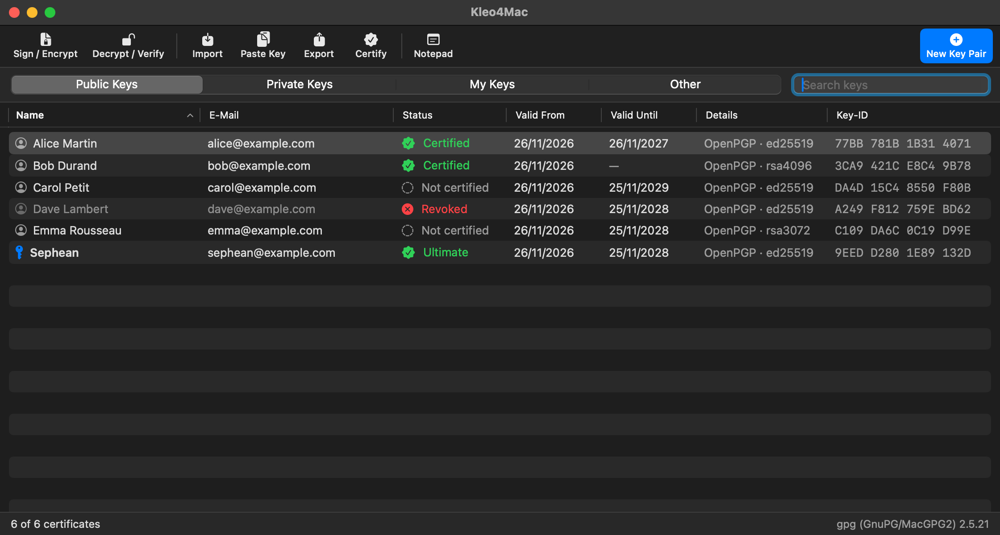
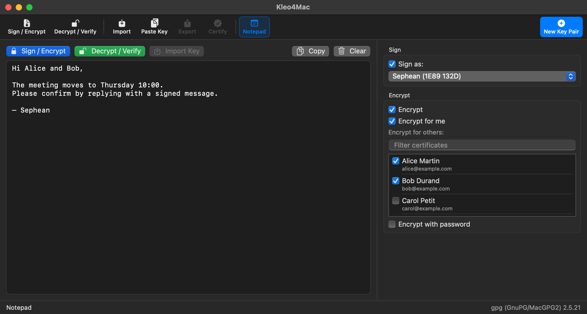

<p align="center">
  
</p>

<h1 align="center">Kleo4Mac</h1>

<p align="center">A native macOS certificate manager for OpenPGP, built on GnuPG.</p>

Create and manage your keys, then sign, encrypt, decrypt and verify text and files from a simple Mac app.



Kleo4Mac is a graphical front end to `gpg`, the same engine used by Kleopatra on Linux and Gpg4win on Windows. Your keys live in your normal GnuPG keyring (`~/.gnupg`), so everything you do in Kleo4Mac also works with `gpg` in the terminal and with any other OpenPGP software, and the other way around.

> Kleo4Mac is an independent project. It is not affiliated with or endorsed by KDE or the Kleopatra project.

## Features

**Certificates**
- Tabs for public keys, private keys, keys imported this session, and other people's keys, plus search
- Create key pairs: ECC Curve 25519 (recommended) or RSA 3072 / 4096, with an expiry date
- Import from files, from the clipboard, or by dropping files on the window
- Export public keys, copy them to the clipboard, back up secret keys
- Details view: fingerprint, key ID, algorithm, validity, user IDs and subkeys
- Right-click menu: Certify, Change End of Validity Period, Change Passphrase, Add User ID, Revoke Certificate, Delete

**Sign / Encrypt**
- Files and text (Notepad)
- Encrypt for yourself, for any number of recipients, and/or with a password
- Clear-signed text and detached signatures (`.sig` or `.asc`)
- Binary (`.gpg`) or text (`.asc`) output



**Decrypt / Verify**
- Picks the right secret key automatically
- Clear results: valid signature, certified or not, invalid signature, unknown signer, expired or revoked key
- Detached signatures are checked against the file next to them
- Never overwrites an existing file

Passphrases are always asked by GnuPG's own secure dialog (pinentry-mac); Kleo4Mac never sees them, except the new passphrase you type when creating a key.

## Requirements

- macOS 14 Sonoma or later
- GnuPG with pinentry-mac, from either:
  - [GPG Suite](https://gpgtools.org), or
  - Homebrew: `brew install gnupg pinentry-mac`
- To build: Xcode or the Xcode Command Line Tools (Swift 5.9+)

## Build

```bash
git clone https://github.com/sephean/Kleopatra4Mac.git
cd Kleopatra4Mac
./scripts/build-app.sh
open build/Kleo4Mac.app
```

The script compiles the app, draws its icon and creates `build/Kleo4Mac.app`. Drag it to your Applications folder to install it.

The app is signed locally only, so the first time macOS may refuse to open it: right-click `Kleo4Mac.app` and choose **Open**.

## Privacy

- Kleo4Mac itself makes no network connections and collects nothing.
- All cryptography is done by GnuPG on your Mac.
- GnuPG can be configured to fetch unknown keys from a keyserver when verifying signatures (`auto-key-retrieve` in `~/.gnupg/gpg.conf`). Remove that option if you want no network access at all.

## Compatibility

Keys created by Kleo4Mac are standard OpenPGP v4 keys: an Ed25519 signing key with a Curve25519 encryption subkey, or RSA with an RSA encryption subkey. They work with GnuPG 2.1+, Kleopatra, Gpg4win, Thunderbird, OpenKeychain, OpenPGP.js and other OpenPGP software.

Interoperability was tested with the `gpg` command line (keys, messages, signatures, files, certifications, revocations, expiry and passwords, in both directions) and with OpenPGP.js.

## Project structure

```
Package.swift              Swift package (macOS 14+)
Sources/Kleo/
  KleoApp.swift            App entry point and menus
  ContentView.swift        Main window: action bar, tabs, certificate table, context menu
  KeySheets.swift          New key, details, expiry, add user ID, certify dialogs
  CryptoViews.swift        Sign/encrypt and decrypt/verify dialogs, Notepad
  AppModel.swift           App state and actions
  GPG.swift                GnuPG backend: runs gpg and parses its output
  Models.swift             Keys, user IDs, subkeys, signature results
scripts/
  build-app.sh             Builds build/Kleo4Mac.app
  make-icon.swift          Draws the app icon
docs/                      Icon and screenshots for this README (demo keys only)
```

## License

[MIT](LICENSE)
